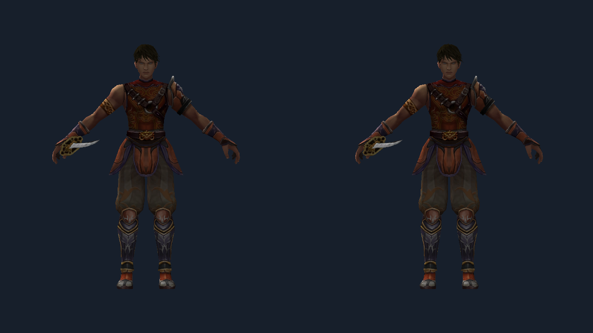

# C43 – régi felszerelések és példányállapotok konverziója

A támogatott fegyverek, páncélok, ékszerek és kövek konverziója szerveren és Unity 6.3-ban működik. A helyi játékpróba az eredeti karakter 52 felszerelésének külön karakterre készített másolatával és három megjelölt tesztesettel történt. Az eredeti, vegyes leltár 76 tárgya változatlan maradt; annak teljes átállítása még nincs kész.

Csak helyi módosítások készültek. Szerverág: `20261103`; Unity UVCS-ág: `/main/unity63-integration-20261103`. Nem történt push vagy Unity-checkin. A VPS és a korábbi Unity-munkakönyvtárak változatlanok.

## Fix fegyversebzés

A fizikai és a mágikus sebzés külön-külön egyetlen érték:

```
fix sebzés = (régi minimum + régi maximum) / 2 + fejlesztési bónusz
```

Az átváltás a natív 1/1000 pontos egységet használja, ezért a fél pont sem vész el. Példa: a tesztelt Kard+9 fizikai értéke **77**, mágikus értéke **80**. Az új tárgyadat és protokoll nem tárol fegyversebzési intervallumot. A régi SQL-forrás és a visszaállítható mentések megmaradnak auditcélra.

## Megvalósítás

- Az offline fordító 10 986 forrásprototípus teljes jegyzékét követi. A felszerelési rész 3 635 forrássort képez 491 natív definícióra. A további 3 100, ide sorolt forrássor konkrét indokkal blokkolt; nincs csendes mezőeldobás.
- A helyi katalógus 1 426 definíciót tartalmaz: 506 korábbi natív definíció, 429 korábban lefordított passzív tárgy és 491 felszerelés. A korábbi kulcsok, tartalomsorok és kiosztott számlálótartományok megmaradtak.
- A natív, név szerinti bónuszjegyzék 143 azonosítót tartalmaz. A HP/SP, sebességek, proc-esélyek, ellenállások, immunitások és más karakterpontok a megfelelő egységgel jutnak el a harci kódhoz és Unitybe. A páncélvédelem a lovaglási minimum alkalmazása előtt számítódik.
- A fejlesztési szintek külön szintkövetelményt és vételi/eladási árat őrizhetnek. A GC227 v5 ezt Unitynek is átadja; a korábbi, felülírás nélküli tartalom továbbra is a régebbi csomagváltozatokat használhatja.
- Mind a nyolc bónuszhely, a zárolás, a három kőhely, a beültetett kő kulcsa és fejlesztése, valamint az ékszer kapacitása, aktív töltése és hátralévő ideje konvertálódik. Az állandó ékszertöltés külön állapot marad.
- A régi bónusztábla tényleges betöltési szabálya külön, a visszaállított forrásból rögzített bemenet. A két ismételt táblaazonosítónál a régi betöltő utolsó sora érvényesül. A meglévő, mai táblából már nem kisorsolható példánybónusz nulla súlyú engedéllyel megőrizhető; ettől nem válik újra kisorsolhatóvá.
- A megjelenés explicit, már létező felszerelés-assetekre mutat. Unity a karakter fajának megfelelő páncélt tölti. A natív tárgykulcsból nem számol régi VNUM-ot.
- Az import egy SQL-tranzakcióban hozza létre a teljes tulajdonost, tárolóit, pénzét és összes példányát, archiválja a teljes régi sorokat, majd törli az importált forráspéldányokat. Az új példányazonosítók a natív kiosztóból érkeznek. A tartós importbizonylat az azonos kérés ismétlését duplázás nélkül kezeli, eltérő ismétlést visszautasít.

## Elvégzett ellenőrzések

- Windows natív GameServer Release-fordítás; az SQL- és katalóguseszközök fordítása.
- 15 célzott CTest, továbbá a független katalógusdigest-ellenőrzés sikeres.
- 41 MariaDB-sémateszt sikeres; friss 000–037 telepítés és a teljes katalógus natív visszaolvasása sikeres.
- A régi v30 adatbázis visszaállítása, v31-frissítése és az eredeti natív tartalom megőrzése ellenőrzött külön adatbázison.
- Az 52 felszerelés importja, natív visszaolvasása, a szándékos tranzakcióhiba utáni teljes visszagörgetés, az újrapróbálás és az eltérő ismétlés elutasítása ellenőrzött.
- Az aktív Unity-források runtime- és editor-assemblyje lefordult a rögzített `6000.3.27f1` eszközeivel. A 37 elemes offline validátorkör sikeres.
- Valódi helyi TLS-kapcsolaton 55 tárgy, három tulajdonosi belépés és egy másik kliens nézete ellenőrzött. A fegyver levétele eltávolítja a 77/80 fix hozzájárulást; visszavétele helyreállítja. A karkötő levétele pontosan 2 500 HP-val csökkenti a maximumot, visszavétele egyszer állítja vissza.
- A három külön teszteset: nyolc bónusz zárolással és törött kőhellyel; hordott tárolóban megőrzött időzített ékszertöltés; állandó ékszertöltés. Ezek az újrabelépések után is pontosan egyeznek.
- A tulajdonos és a másik kliens valódi páncél- és fegyvermeshével is lefutott a levétel/visszavétel és az újrabelépés ellenőrzése. A mellékelt kép a valódi hálózati megjelenéscsomagokat alkalmazó renderből készült.
- A játékpróba után a natív SQL-olvasó mind az 55 példány teljes állapotát visszaellenőrizte. A pénz és az importbizonylat megmaradt. Az eredeti régi leltárak/prototípusok, a korábbi natív tárgyak/pénztárcák/tanulási adatok és a 10 megőrzött Unity-beállítás változatlanok.



## Határok és következő munka

Ez nem a teljes régi itemrendszer készre jelentése. Az eredeti karakter további 24 példánya fogyóeszköz, alapanyag, küldetéstárgy vagy láda. A teljes tulajdonost csak az összes érintett típus és állapot lezárt konverziója után szabad átállítani; részleges vagy üres natív leltár nem készült számára.

Külön munkát igényelnek a blokkolt felszereléscsaládok, többek között a hiányos fejlesztési láncok, speciális `extra_proto` adatok és a régi íj/lőszer-szabályok. A meglévő felszerelésállapotok átvitele nem köti át automatikusan a régi előállítási, kovács-, ékszertöltőanyag-, bolt-, drop- és questhivatkozásokat. Az importált ékszerprofil a meglévő töltés megőrzését támogatja; nem talál ki új töltőanyagot vagy receptet.

A Windows/Android/iOS exportált klienscsomagokból új build ebben a munkában nem készült; a játékpróbák a Unity 6.3 Editor közös klienskódjával történtek. Android- és iOS-eszközön ez a konverzió még nincs ellenőrizve.

Az offline belépési pont: `SRC/Tools/ItemCatalogBuilder/convert_legacy_equipment.py --help`. Nem fogad SQL-végpontot. Teljes, ellenőrzött forrásmentést, teljes mappinget, korszerűsített megőrzendő katalógust és ellenőrzött effektív bónusztáblát kér. A jelöltet a natív katalógusellenőrzőnek is el kell fogadnia. `--owner` esetén a tulajdonos teljes régi leltárának konvertálhatónak kell lennie; a kimenet önmagában nem kiadható teljes migráció.

Gépi bizonyíték: [2026-11-10_legacy_equipment_conversion.evidence.json](2026-11-10_legacy_equipment_conversion.evidence.json).
