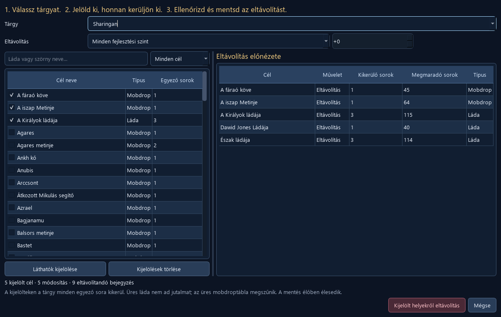

# Tömeges élő eltávolítás és a katalógusszerkesztő gyorsítása

Elkészült és telepítve a helyi szerverkezelőben. Egy tárgy egyszerre több ládából és mobdroptáblából kivehető név szerinti kijelöléssel. A közös mentést minden futó core újraindítás nélkül veszi át. A 637 halasztott forrástétel változatlan.

## Használat

- Tárgyat kijelölve a katalógusban: **Eltávolítás több helyről…**.
- A **Ládák** vagy **Droptáblák** oldalon: **Tömeges módosítás… → Tömeges eltávolítás…**. Ugyanez a menü a korábbi tömeges hozzáadást is tartalmazza.
- Válaszd ki a tárgyat; a listában csak azok a ládák és mobdropok látszanak, amelyekben szerepel. Név szerint szűrhetsz, a látható találatokat együtt kijelölheted, és a szűréssel elrejtett kijelölések megmaradnak.
- Alapból a tárgy minden fejlesztési szintje és minden egyező sora kikerül. A **Csak a megadott fejlesztési szint** választással szűkíthető a művelet.
- Az előnézet célonként mutatja a kikerülő és megmaradó bejegyzéseket. A **Kijelölt helyekről eltávolítás** egyetlen ellenőrzött kiadást ment.

Kizárólag a kijelölt célok módosulnak. Az utolsó jutalmát elvesztő láda explicit „nincs jutalom” sorsolást kap; nyitható marad. Az utolsó sorát elvesztő mobdroptábla megszűnik. Mindkét eset látható az előnézetben. A megmaradó súlyozott sorok relatív esélyei természetesen újraoszlanak. A mentés natív validálása, verzióütközés-kezelése, SQL-tranzakciója és minden core-ra kiterjedő visszaigazolása a meglévő élő jutalomrendszert használja. Új migrációra és szerverbinárisra nincs szükség.

## A lassulás oka és a javítás

A felület több műveletnél ismételten rekurzívan másolta és feldolgozta a teljes katalógust. Ugyanazt a tárgylistát egy új kijelölés vagy visszalépés is újra létrehozta. A láda tárgyadatainak megnyitásakor a kezelő egy teljes, de rejtett jutalomszerkesztőt is felépített. Nagy bónusztáblánál minden sor külön létrehozta az azonos bónuszválasztó-listát.

A SQL cellák változatlan szövegek vagy nullok: a sorok önálló másolatához nincs szükség minden cellán végighaladó rekurzív másolásra. A bemeneti táblák továbbra is elkülönülnek a szerkesztett adatoktól. A felület adatbázis-válaszonként megtartja a feldolgozott, olvasásra használt modelleket, névindexeket és választólistákat. Csak új válasz vagy másik szervercsomag esetén készül új nézet. A szűrés nem számítja újra a neveket; azonos szűréshez nem épül új táblázat. A meglévő ládák tárgyadatainál nem készül el a külön élő tartalomszerkesztő rejtett másolata. A bónuszválasztók megosztják az azonos listát.

Ugyanazzal a teljes helyi katalógussal és bekapcsolt Python-profilerrel, olvasási műveleteket mérve:

| Művelet | Előtte | Utána |
|---|---:|---:|
| Betöltött katalógus felépítése | 11,15 s | 1,32 s |
| Fegyverkategóriára váltás | 3,12 s | 0,060 s |
| Egy tárgy kijelölése | 1,35 s | 0,008 s |
| Vizsgált fegyver szerkesztőjének megnyitása | 9,32 s | 1,32 s |

A visszalépés a katalógusra 0,009 s, a droplista megnyitása 0,082 s, a ládalista megnyitása 0,033 s, a legnagyobb, 170 bejegyzéses láda tárgyadatainak megnyitása 0,045 s volt az új mérésben. Ezek instrumentált, helyi offscreen Qt-mérések, nem általános sebességígéretek. A kezdeti SQL-olvasás idejét nem tartalmazzák. A korábbi mérés első négy művelete után egy meglévő, nulla súlyú bónuszsor felületi validációja megállította a forgatókönyvet; ezt a natív szabállyal egyező 0–1 000 000 tartománnyal javítottuk, és külön körbejárási teszt ellenőrzi.

## Ellenőrzés

- Négy releváns CTest sikeres: `container_opening`, `catalog_editor`, `bulk_rewards_editor`, `live_rewards_mariadb`. A katalógusszerkesztő 87, a közös jutalomszerkesztő 11, az elkülönített valódi MariaDB-próba 9 esetet futtatott.
- A tömeges eltávolítás vizsgálja az ismétlődő sorokat, a kijelölt célok elkülönítését, a fejlesztési szint szerinti szűkítést, az üres ládát és a kiürülő mobdroptáblát, az eltűnt cél visszautasítását, a rejtett kijelöléseket és a sikertelen szerkesztés visszaállítását.
- A gyorsítás külön próbája ellenőrzi a bemeneti adatok elkülönítését, az új kiadásra frissülő gyorsítótárat és a közben megőrzött tárgypiszkozatot. Nulla súlyú bónuszsor is változatlanul visszaolvasható a felületről.
- Tizenkét tárgyszerkesztési munkafolyamat és hat kisablakos/navigációs Qt-próba sikeres. Teljes valós katalógussal öt vegyes, név szerinti cél eltávolítási előnézete is ellenőrzött, adatírás nélkül.
- Unity **6000.3.27f1** Editor fordítás és új **`live-reward-remove`** validator sikeres. Tényleges kliensablakos nyitás két ládán, valamint tényleges mobtámadás és -ölés a közös eltávolítás előtt és után. Ugyanabban a klienskapcsolatban az új nyitásokból és az új ölésből már nem érkezett a kivett tárgy. Egy korábbi Ready nyitás a már megmutatott jutalmat adta. Újrabelépés után mind a 8 előzőleg megszerzett darab megmaradt.
- Mindhárom core visszaigazolta az eltávolítást. Az öt szerverfolyamat PID-je az előkészítés, módosítás, játékpróba, visszaállítás és kezelőtelepítés alatt változatlan. A többi játékos item- és pénztárcaállapota változatlan.
- A próba végén visszaállt az eredeti 183 mobcsoport / 9027 dropsor, nincs aktív teszt-ládatartalom, és a meglévő quest eredeti bájtjai is visszaálltak élő újratöltéssel. A szerver és a játékosok tartós katalógushivatkozása nem változott.

A kezelő frissítése a `D:/AurigaGlobal/Server2-Local/manager` mappában telepítve. Ehhez a munkához nem történt szerverújraindítás. Nem futott FreeBSD build, standalone/mobile Unity-build, távoli csomagpróba, terhelési vagy többgépes hálózatkiesési próba.

[Gépi bizonyíték](2026-11-17_bulk_reward_removal_performance.evidence.json).
