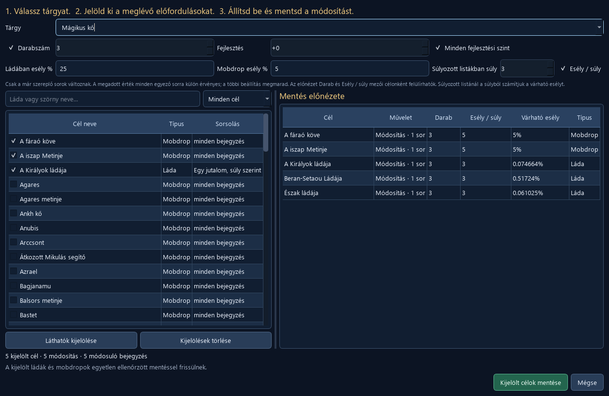

# Esély és darabszám módosítása több meglévő láda- és mobdropban

Elkészült a külön **Tömeges módosítás… → Esély és darabszám több helyen…** művelet. A katalógusban kijelölt tárgyat előre kiválasztja; a láda- és mobdroplistából is elérhető. A normál felület játékbeli neveket használ.

A listán csak azok a célok látszanak, amelyekben a tárgy már szerepel. Kereshetsz, kijelölheted az összes látható célt, és keverheted a ládákat és mobdropokat. A szűréssel elrejtett kijelölések megmaradnak. Alapból minden fejlesztési szint egyező sorait módosítja, de egy adott szintre is szűkíthető.

A **Darabszám** és az **Esély / súly** külön kapcsolható. Kikapcsolt mezőnél az eredeti érték marad meg. Külön megadható a láda és a mobdrop százaléka, illetve a súlyozott listák súlya; az előnézet a teljes lista alapján számolja a várható esélyt. A megadott érték minden egyező sorra külön érvényes. Az előnézet darabszáma és esélye/súlya célonként felülírható, a cellák súgója pedig mutatja az előző és új darabszámot, valamint a várható esélyt.

Új sort nem ad hozzá. A ritka bónusz, a tárgy fejlesztési szintje, a mobbejegyzés karakterszint-korlátai és a többi beállítás megmarad. A ki nem jelölt ládák akkor is változatlanok, ha közös alap jutalomprofilt használnak. A változatlan értékű és az időközben nem egyező bejegyzések kimaradnak.

A mentés egyetlen, teljesen validált SQL-kiadást publikál. Hibánál nincs részleges módosítás. Minden futó core újraindítás nélkül átveszi; a teljes sikerhez az összes visszaigazolását megvárja a kezelő. Új migrációra, szerverbinárisra és hálózati csomagformátumra nincs szükség.

Ellenőrzés:

- Négy releváns CTest sikeres: `container_opening`, `catalog_editor`, `bulk_rewards_editor`, `live_rewards_mariadb`. A közös szerkesztő 17 modell-/Qt-esetet, a valódi elkülönített MariaDB-csoport 10 esetet tartalmaz.
- Külön próbák a csak darabszámot vagy csak esélyt módosító mentésre, az ismétlődő sorokra, szintszűrésre, célonkénti felülírásra, súlyozott esélyszámításra, súlyösszeg-túlcsordulásra, hibás adatokra, új sor hozzáadásának kizárására, piszkozat-visszaállításra és az eredeti adatok megőrzésére.
- Tizenkét tárgyszerkesztési munkafolyamat és hat navigációs/kisablakos Qt-próba sikeres. Öt valós, név szerinti cél teljes adathalmazos előnézete adatírás nélkül ellenőrzött.
- Unity **6000.3.27f1** fordítás és új **`live-reward-update`** validator sikeres. Két láda tényleges kliensablakos megnyitása és tényleges mobtámadás/ölés az átállítás előtt és után, ugyanabban a klienskapcsolatban.
- Egy közös `plan_update` mentés a két láda és a mob **2 darab / 100%** jutalmát **3 darab / 75%** értékre állította. A ládák valódi Ready-válasza már az új darabszámot és a 7500 bp esélyt tartalmazta. A nyitások és mobölések az új 3 darabot adták sikeres sorsoláskor; sikertelen sorsolásnál nem keletkezett hibás jutalom. A próba megvárta a tényleges új nyerést mindkét ládánál és a mobnál.
- A publikálás előtt előkészített nyitás a megmutatott régi 2 darabot adta. Újrabelépés után mind a 17 megszerzett darab megmaradt. Mindhárom core visszaigazolta az átállítást, az öt szerverfolyamat PID-je végig azonos maradt.
- A próba eredeti jutalmai és questbájtjai visszaálltak. Más játékosok item- és pénztárcaállapota változatlan, a 637 halasztott forrástételhez nem nyúltunk.

Nem futott FreeBSD build, standalone/mobile Unity-build, távoli szervercsomag-, terhelési vagy többgépes hálózatkiesési próba. A [teljes droplista-munkalap és a TXT-script adaptere](../../server_manager_drop_workbench_direction.md) külön javaslat, még nincs megvalósítva.

[Gépi bizonyíték](2026-11-17_bulk_reward_update.evidence.json).
