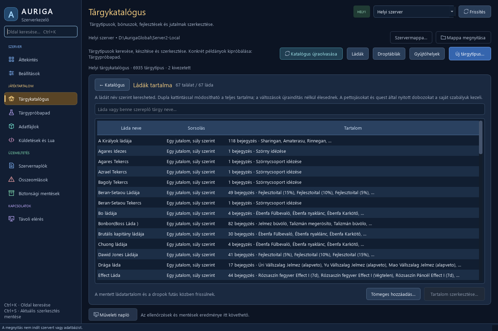
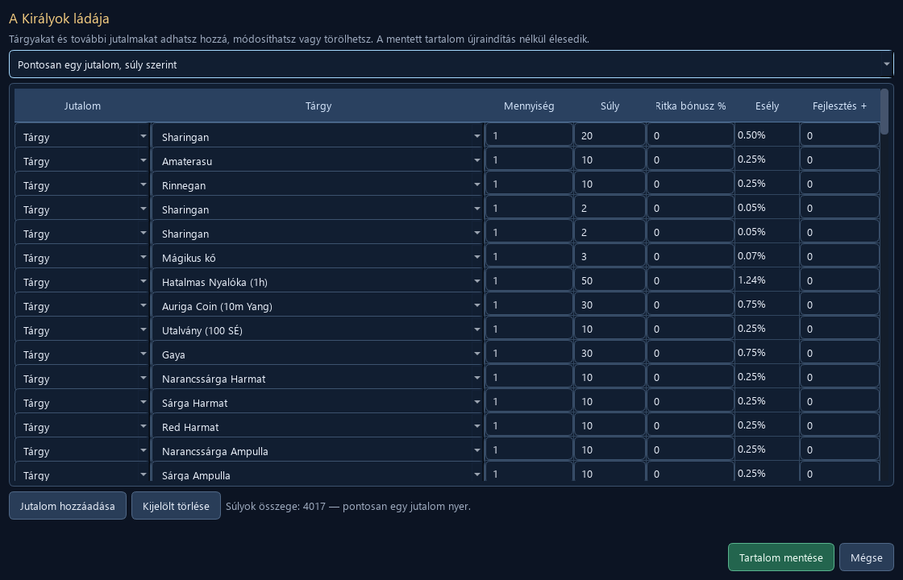
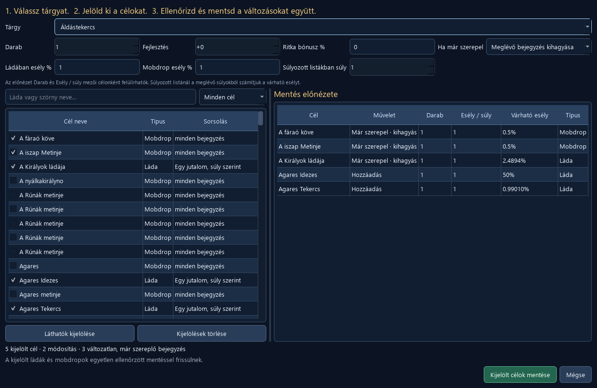

# Élő ládatartalom és közös hozzáadás több ládához / mobdrophoz

Elkészült és telepítve a saját helyi szervercsomagban. A Szerverkezelőben a ládák teljes tartalma módosítható, és egy meglévő tárgy egyszerre több ládához és mobdroptáblához hozzáadható. A mentések futó szerveren élesednek. A felületen a tárgyak, ládák és mobok játékbeli neve szerepel. A 637 halasztott forrástétel változatlan.

## Használat

1. **Tárgykatalógus → Ládák**: keress a láda vagy egy benne szereplő tárgy nevére. Jelöld ki, majd **Tartalom szerkesztése…**. A teljes jutalomlista bővíthető, törölhető és módosítható: tárgy, darabszám, fejlesztés, ritka bónusz, sorsolás és esély/súly.
2. Egy tárgyat a katalógusban kijelölve a **Hozzáadás több helyre…** előre kiválasztja azt. A **Tömeges hozzáadás…** a láda- és mobdroplistából is elérhető.
3. Jelöld ki név szerint a kívánt ládákat és mobokat. A látható találatok együtt kijelölhetők; a szűrés által elrejtett kijelölések megmaradnak. Vegyes célok is menthetők egy műveletben.
4. Állítsd be a darabszámot és az esélyeket. Az előnézetben a **Darab** és **Esély / súly** célonként felülírható. Súlyozott listán a várható esély a többi bejegyzéstől is függ.
5. A már szereplő tárgy és fejlesztési szint alapból kimarad. A **Meglévő bejegyzés módosítása** választással a meglévő sorok is frissíthetők.
6. **Kijelölt célok mentése**: minden változás egy ellenőrzött verzióban kerül adatbázisba. A kezelő megvárja az összes futó core visszaigazolását; elhúzódó átvételnél külön jelzi a mentett, de még függő állapotot.

Az élő szerkesztés a használattal és kulccsal nyitható ládákra vonatkozik. A pettojások és quest által kezelt dobozok saját szabályaikat használják. Új tárgydefiníció létrehozására továbbra is a teljes katalógus szerkesztési szabályai érvényesek; az online művelet a meglévő tárgyak jutalomlistákba helyezése.

## Mentés és futó játékműveletek

A **044_live_container_loot.sql** migráció az eddigi élő mobdropkiadáshoz kapcsol per-láda tartalmi felülírásokat. A láda- és mobmódosítás ugyanabban a SQL-tranzakcióban, ugyanazon verzióellenőrzéssel váltja az aktív kiadást. Hibás adat vagy másik szerkesztő közben mentett változása esetén nincs részleges mentés. A korábbi változatok auditként megmaradnak.

A teljes statikus itemkatalógus és a tartós itemállapot katalóguspinnje nem változik. A betöltő külön jutalomnézetet készít és validál, majd core-onként egyben cseréli. Az összes core nem egy órajelben vált; teljes sikert a kezelő csak mindegyik futó core friss visszaigazolása után jelez. Hibás új kiadás esetén a core az utolsó jó nézetet tartja meg.

Azonos alap-profilt használó ládák közül kizárólag a kijelöltek változnak. Egy már előkészített nyitás a játékosnak megmutatott jutalomverziót tartja a megerősítésig. A következő nyitás már az új tartalmat használja. Az eredmény a meglévő natív jutalmazási és tartós itemműveleteken halad át. A packetkiosztás és a Unity runtime codec módosítása nem volt szükséges; a Unity validator a tényleges kliensablakot és megerősítő gombot használja.

## Ellenőrzött eredmény

- MSVC Release natív fordítás: GameServer, CatalogEditorTool, ContainerOpeningTests és ItemCatalogRuntimeTests sikeres.
- Mind a hét releváns CTest sikeres: `container_opening`, `catalog_editor`, `bulk_rewards_editor`, `drop_reload_control`, `live_rewards_mariadb`, `live_mob_drops_mariadb`, `item_catalog_runtime_mariadb`. Ezekben 87 katalógusszerkesztő-, 5 új közös szerkesztő-, 7 vezérlési és 8 új valódi MariaDB-eset is lefutott. A Qt-próbák nem maradtak kihagyva.
- Hat további navigációs és kisablakos Qt-próba sikeres. Teljes helyi katalógussal olvasási előnézet készült: 67 láda, egy 118 bejegyzéses láda teljes szerkesztője, valamint három ládát és két mobot közösen kijelölő előnézet. A telepített, csomagolt Windows-alkalmazásban is megnyílt a ládalista és mindkét új szerkesztő.
- A nagy ládák tárgyválasztóinak méretezése gyorsítva: a legnagyobb, 170 bejegyzéses láda megnyitása ugyanazzal a bekapcsolt Python-profilerrel 26,48 másodpercről 6,19 másodpercre csökkent. A teljes jutalomlista oda-vissza kiolvasása egyezett. A módosítás után a két szerkesztő CTest és a kisablakos Qt-próbák ismét sikeresek.
- Unity **6000.3.27f1** Editor fordítás sikeres; az új `live-reward-bulk` validator valódi helyi TLS-játékfolyamatot futtatott.
- Két külön láda tényleges megnyitása a kliensablak megerősítő gombjával, és normál 103-as mob tényleges megtámadása/megölése: először 2 darab jutalom.
- Az éles szerkesztési API-n a két láda és a mob egyetlen közös mentéssel 3 darabra változott. Ugyanazon klienskapcsolat új nyitásai és következő ölése már 3 darabot adott. A közben előkészítve tartott nyitás a korábban megmutatott 2 darabot adta.
- Újrabelépés után mind a **17** megszerzett darab megmaradt. Mindhárom futó game core minden verziót visszaigazolt. Az öt szerverfolyamat PID-je az összes jutalommódosítás és visszaállítás alatt végig azonos maradt.
- A többi játékos natív item- és pénztárcaállapota változatlan. A próba végén visszaállt az eredeti 183 mobcsoport / 9027 dropsor, nincs aktív teszt-ládatartalom, és az ideiglenesen bővített meglévő quest eredeti bájtjai is visszaálltak élő quest-újratöltéssel.
- A végső telepítés és manifest 251 állománya egyezett a friss builddel. A statikus és végső aktív jutalomhash ismét az eredeti `741577036e2516600031bd492d5b3f22d3f14b0561321586dfd431fa5a945c85`. A forráskatalógus SHA256-ja változatlan: `9ab3dac7f81d2898ab89aeeca641bffc4f59b28ac5f7683d080282ea9913babd`.

A szerverkód egyszeri telepítésekor kellett újraindítás. Az ezt követő láda- és mobdropmentések, a közös módosítás és a teszt utáni visszaállítás **újraindítás nélkül** történtek. A friss kezelő helye: `D:/AurigaGlobal/Server2-Local/manager/AurigaServerManager.exe`.

Nem futott FreeBSD build, standalone/mobile Unity-build, távoli szervercsomag szerkesztése, terhelési vagy többgépes hálózatkiesési próba. A korábbi teljes legacy-forrástakarítás ettől külön nyitott munka.

[Gépi bizonyíték](2026-11-17_live_chests_bulk_rewards.evidence.json).
