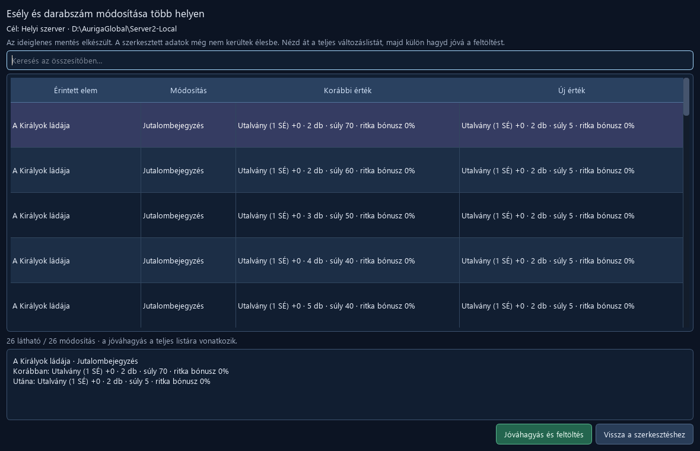
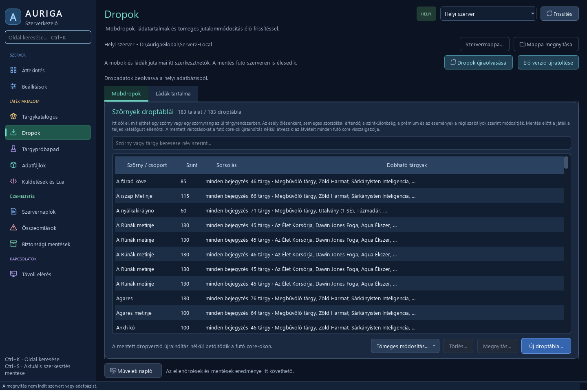

# Külön Dropok oldal és kötelező mentési jóváhagyás

2026-11-17 · szerverág: `20261103`

A szerverkezelőben külön **Dropok** menüpont található, **Mobdropok** és
**Ládák tartalma** fülekkel. A tárgykatalógus kizárólag a tárgytípusok
szerkesztőjét tartja meg; mentett ládatípusból hivatkozás vezet a Dropokhoz.
A két oldal közös olvasási gyorsítótárat használ, és dropfrissítés közben
megőrzi a nem mentett tárgyszerkesztést. A Dropok oldal a katalógus előzetes
megnyitása nélkül is betöltődik. A Ctrl+S itt nem ment el rejtett tárgypiszkozatot.

Minden kézi adatírás előtt helyi, tartós ideiglenes mentés és külön összesítő
készül. A név szerinti, kereshető lista megmutatja a régi és új értékeket.
Csak a **Jóváhagyás és feltöltés** gomb indítja az írást. Visszalépéskor a
piszkozat és az ideiglenes mentés megmarad, éles adat nem változik.
Az Enter alapértelmezett művelete a visszalépés.

A jóváhagyás az adott mentési művelet teljes változáslistájára és célgépére
vonatkozik. A közzétevő a pillanatképet olvassa vissza; későbbi űrlapmódosítás
nem cserélheti le a jóváhagyott adatokat. Az app ellenőrzi a pillanatkép és
a hozzá másolt feltöltési fájlok ellenőrzőösszegét. Megmarad a meglévő
adatbázis-verzióellenőrzés, natív validálás és fájlmentési ütközésvédelem.
Sikertelen vagy bizonytalan kimenetelű írást nem ismétel meg automatikusan.

Az érintett belépési pontok: tárgytípus, mobdroptábla mentése/törlése,
ládatartalom, tömeges hozzáadás/eltávolítás/esély és mennyiség; helyi és távoli
konfiguráció-, adat- és questfájlmentés; próbapadműveletek; SSH-profilok;
mentési beállítások, visszaállítás, archívumimport; távoli feltöltés, build,
telepítés, csomagműveletek és mindkét questaktiválási útvonal.
Buildnél és véletlen próbapadműveletnél a jóváhagyott végrehajtási paraméterek
látszanak, az eredmény a művelet futásakor keletkezik.

Az ideiglenes mentések helye:
`%LOCALAPPDATA%/AurigaServerManager/temporary-changes`.
Ezek az adatfájlok tartalmát is tárolják. A szerkesztett SSH-jelszó értéke
nem kerül a pillanatképbe; a titkos mezők a listában takarva jelennek meg.
A mentési állapot külön naplózott: előkészített, jóváhagyott, feltöltés alatt,
alkalmazott vagy bizonytalan kimenetelű.

A láda- és mobdropmódosítások jóváhagyás után továbbra is újraindítás nélkül
érvényesülnek. A statikus tárgydefiníciók mentésének meglévő szerverleállítási
feltétele megmarad.

## Ellenőrzések

- `manager_change_review`: 21 teszt; tartós mentés az összesítő előtt,
  visszalépéskor nincs helyi/távoli/SQL-feltöltés, pontos jóváhagyott bájtok,
  egyszer használható jóváhagyás, célváltás, módosult pillanatkép/fájl tiltása,
  hibás feltöltés, titkos mezők, teljes keresési hatókör és Enter viselkedése.
- `catalog_editor` és `bulk_rewards_editor`: natív modell/validátor és Qt
  szerkesztési útvonalak. A tömeges összesítő minden kijelölt célt tartalmaz;
  a régi és új súly/esély egysége külön helyesen jelenik meg.
- 46 helyi GUI/natív/backend integrációs teszt, 23 RPC/célgép GUI teszt,
  25 SSH GUI teszt, 15 mentési teszt, 14 csomagkezelőteszt.
- Távoli munkafolyamatok: 53 teszt, ebből 2 kihagyott. Jelszókezelés:
  16 teszt, ebből 2 kihagyott. A távoli írási folyamatok izolált helyi
  csatornán futottak, külső FreeBSD-gépre nem publikáltunk.
- 12 tárgyszerkesztési munkafolyamat és 7 elrendezési/áttekinthetőségi teszt.
- Olvasási próba a helyi teljes adatkészlettel: 183 mobdroptábla, 9031 bejegyzés,
  67 szerkeszthető láda; az összesítő előnézete 6 cél 26 változtatását mutatja.
  Az előnézetet nem hagytuk jóvá, adatírás nem történt.
- Konzol nélküli csomag építése, mindkét natív itemsegéd indítása és a
  telepített alkalmazás menüjének, mobdrop- és ládafülének kézi UI-ellenőrzése.
  A telepített app mentési összesítőjét is megnyitottuk, majd Escape-pel
  visszaléptünk: az app visszaigazolta, hogy nem történt feltöltés.

A kezelő telepítése teljes mentéssel történt. A telepített fájlok és a
csomagjegyzék ellenőrzőösszege egyezik; az öt futó szerverfolyamat azonosítója
és a szerverprogramok bájtjai változatlanok. Az eredeti élő dropverzió és a
felhasználó korábban meglévő ládatartalom-felülírása megmaradt. A 637
merge-re váró forrástételhez nem nyúltunk.

Új Unity-fordítás vagy játékmenetpróba ebben a munkában nem futott: a változás
a szerverkezelő navigációját és írás előtti jóváhagyását érinti, csomagformátumot,
szerverjátékmenetet vagy Unity-kódot nem módosít.

[Gépi bizonyíték](2026-11-17_drop_page_and_approved_changes.evidence.json)

