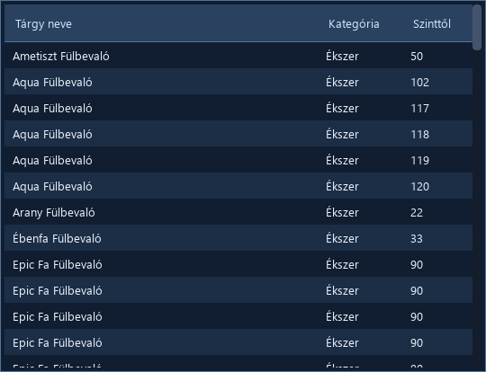
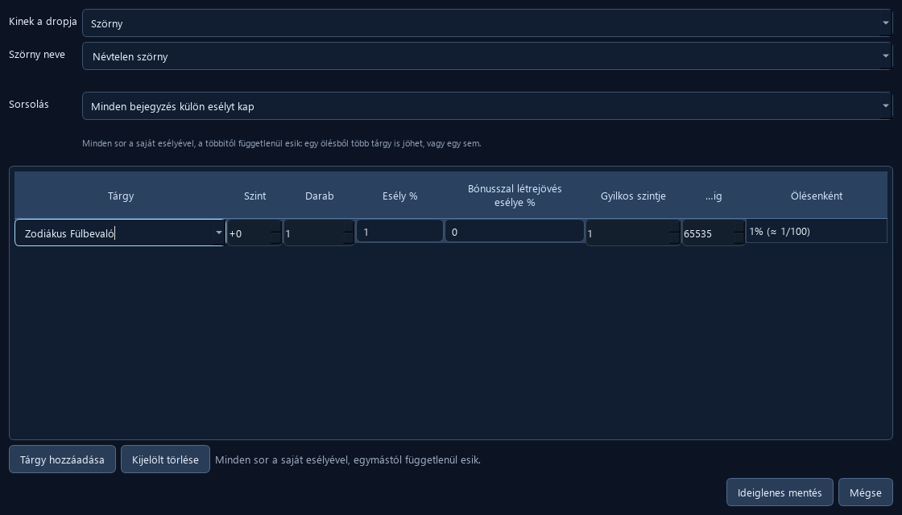

# Mobdrop bónuszolás és ékezetfüggetlen névkeresés

A CombatSystem a közös MakeMobDropGrant átalakítón keresztül adja át a
kisorsolt tárgyat. A droptábla pozitív bónuszolási esélye így eljut a tárgy
létrehozásáig, és felülírja a tárgy alapértékét. A 0 megtartja az eddigi,
tárgyonkénti alapbeállítást. A fejléc, a mezők súgója és az összesítő a
„Bónusszal létrejövés esélye %” megnevezést használja. A Unity ládanyitási
előnézete is érthető névvel és tényleges százalékkal mutatja az értéket.

A tárgy- és szörnyválasztók normalizált keresési szerepen keresztül keresnek,
az eredeti nevek és tárgyazonosság megtartásával. A „fulbevalo” a teljes helyi
katalógusban mind a 94 egyező nevet megtalálta; a kilenc karakter begépelése
és a lista előállítása 0,076 másodpercet vett igénybe a Qt-próbában. Ez nem
általános teljesítménygarancia. Egy-két találatnál a fejléc és a keret helyét
is beleszámítjuk a lista magasságába, hogy az utolsó sor kattintható maradjon.

Ellenőrzések:

- 12 Qt-interakciós teszt, köztük ékezet nélküli keresés, hosszú magyar
  magánhangzók, kombináló ékezetek, eredeti név és kulcs kiválasztása,
  változó forrásmodell, görgetés és Escape.
- Hét CTest-csomag sikeres: mob_drops, persistent_items, catalog_editor,
  bulk_rewards_editor, manager_change_review, manager_pending_changes,
  manager_name_picker.
- A natív tárgyteszt 5550 ellenőrzést teljesített a klienspróba csomagjainak
  exportálásával. A négy új eset a valódi droptervezőn, várakozó kiosztáson,
  tárgygyáron és csomagkódolókon halad át: pozitív felülírás nulla
  alapértéknél, kis esély 100%-os alapértéknél, és mindkét 0-s alapműködés.
- Unity 6000.3.27f1 az aktív 20261103 projektet újrafordította; a natív
  csomagokat a tényleges runtime dispatcher és inventory UI dolgozta fel.
  Mind a négy eset pontos bónuszértékekkel, normál helyekkel, tooltipben és
  ismételt inventoryfrissítés után is sikeres. Az attribute és container
  validátorok is sikeresek (4917, illetve 13262 ellenőrzés).
- A telepített kezelőben is megfigyeltük a „fulbevalo” keresés listáját és
  az új fejlécet. A próbát mentés nélkül bezártuk.

Új hálózati formátumra nem volt szükség. Élő, teljes harci moböléses próba
nem futott; a négy új klienseset a natív tervező/gyár által előállított
csomagokat dolgozza fel. A tesztek nem töltöttek fel droptábla-adatot.

A kezelő frissítése és a három futó helyi game core szabályos újraindítása
megtörtént; a Database és LoginServer folyamata megmaradt. A katalógus,
az aktív dropverzió, az egy meglévő ládatartalom-felülírás és a 637 halasztott
forrástétel változatlan. A felhasználó nyitott Gyalog/Aqua Szilánk (1 db,
1%, 80–100. gyilkosszint) szerkesztése ideiglenes, feltöltésre váró mentésként
megmaradt, és a telepített appban újra megnyitható volt.

A Unity lemezfigyelmeztetését a generált natív gyorsítótár C:-re mozgatásával
oldottuk fel. Az eredeti buildútvonal junctionként működik, a négy ellenőrzött
buildfájl hash-e megmaradt. Ez nem érintette a forrásokat vagy a szerveradatokat.

