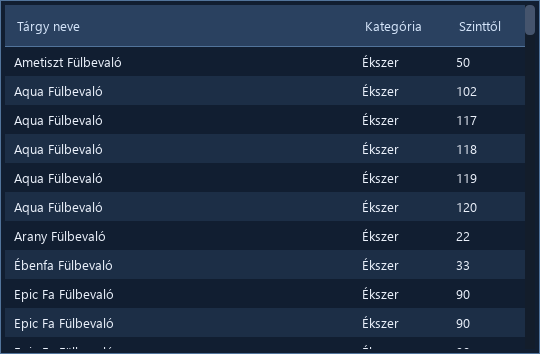

# Görgethető név szerinti találatok gépelés közben

Az eddigi soron belüli kiegészítés helyett külön találati lista nyílik.
A teljes név részletére is lehet keresni, kis- és nagybetűtől függetlenül.
A lista 12 soros nézetben minden találatot megtart; egérrel, görgetéssel és
billentyűzettel is választható. A kategória és a szint segít az azonos nevű
tárgyak megkülönböztetésében, az adatbáziskulcs továbbra is belső adat.

A közös beállítás a tárgyválasztókban, ládatartalmakban, tömeges jutalom-
műveletekben és a mobválasztóban is érvényes. A választás az űrlapot módosítja;
a meglévő ideiglenes mentés és közös jóváhagyás munkafolyamata érvényes marad.

Ellenőrzések:

- 9 Qt-interakciós teszt: gépelésre megnyíló lista, teljes találatszám,
  részletkeresés, magyar ékezetes szöveg, görgetés, billentyűzetes választás,
  azonos nevek külön kulcsa, kattintás a szint oszlopán, Escape és üres találat.
- A meglévő `catalog_editor` és `bulk_rewards_editor` CTest-csomagok sikeresek.
- A teljes helyi katalógusban a „fül” keresés 119 találatot adott, görgethető
  listában. A nézet létrehozása és bezárása nem módosította a katalógust vagy
  az élő jutalomverziót.
- Konzol nélküli csomagépítés és a csomagolt natív segédek indítási próbája.
- A telepített alkalmazásban is megjelent a „fül” találati listája; görgetés
  után az „Ezüst Fülbevaló” kattintással kiválasztható volt. A próbaablakot
  mentés nélkül bezártuk, a Dropok oldal változatlanul 183 táblát mutatott.

GameServer- vagy Unity-protokollváltozás nincs; Unity-fordítás és új
játékmenetpróba ehhez a kezelőfelület-módosításhoz nem futott.

