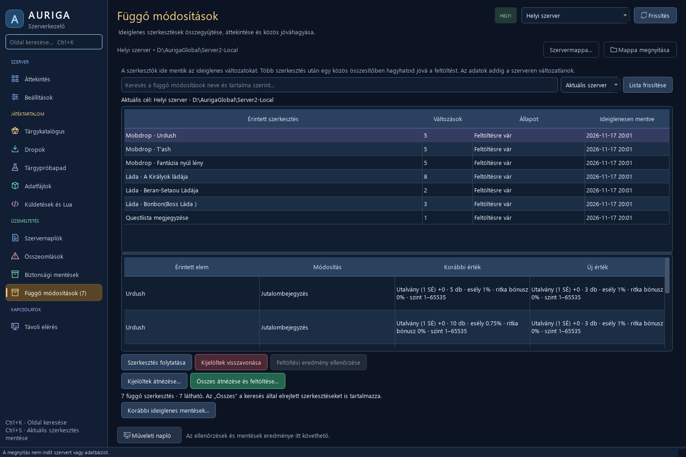
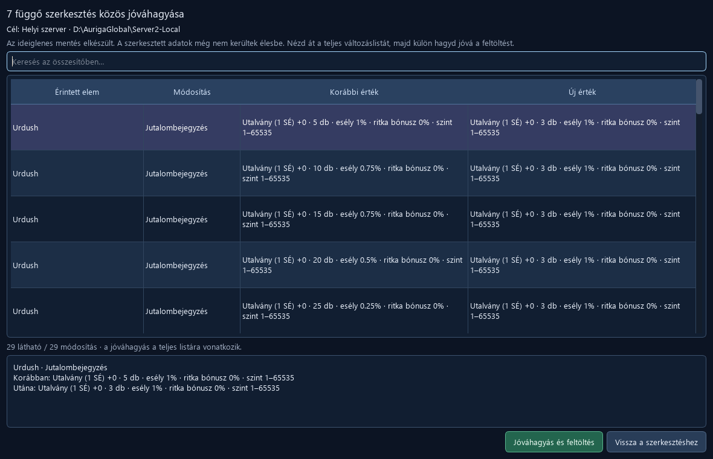

# Függő módosítások: több szerkesztés, egy közös jóváhagyás

2026-11-17 · szerverág `20261103`

A szerverkezelő külön **Függő módosítások** oldalt kapott. Az **Ideiglenes
mentés** a helyi listába ment, és több szerkesztés után az **Összes átnézése
és feltöltése…** egyetlen közös, kereshető összesítőt nyit. A feltöltés csak
ennek a **Jóváhagyás és feltöltés** gombjával indul el. A kijelölt részhalmaz
külön is jóváhagyható. A keresés által elrejtett tételek az „Összes” csomagban
továbbra is szerepelnek.

A tervezetek az app újraindítása után is megmaradnak, a célgépet tartósan
azonosítják. A menü számlálója mutatja a függő tételeket. A **Minden szerver**
szűrővel más célgépek mentései is láthatók; feltölteni az eredeti cél kiválasztása
után lehet. A korábbi verzió ideiglenes pillanatképei külön megtekinthetők és
kifejezetten átvehetők az új listába.

A tárgy- és dropnézet, valamint a fájlszerkesztő az ideiglenesen mentett
változatot nyitja újra. Ugyanannak a tárgynak, ládának, mobdroptáblának vagy
fájlnak az újabb mentése a meglévő tervezetet frissíti. Az összehasonlítás az
eredeti éles állapotot és a legutolsó tervezetet mutatja. Egy tömeges jutalom-
szerkesztés célonként szerepel, ezért egyetlen láda módosítása a többi cél
visszavonása nélkül elhagyható. Az új tárgykulcsokat a tervezet lefoglalja;
ugyanabban a csomagban már rájuk lehet hivatkozni a jutalmakban.

## Tárolás és feltöltés

A jegyzék és a tartós pillanatképek a
`%LOCALAPPDATA%/AurigaServerManager/temporary-changes/pending` mappában vannak.
A teljes kiinduló katalógus egyszer, megosztott alappillanatképként tárolódik;
az egyes tételek csak a saját műveletüket és a változáslistájukat tartalmazzák.
A fájlok pontos bájtjai és a távoli feltöltés fájlmásolatai is megmaradnak.
Az összesítő a titkos mezőket eltakarja; az SSH-jelszó értékét a pillanatkép
nem tárolja. Jelszavas profil mentésénél újraindítás után szükség lehet az
új jelszó ismételt megadására.

A jóváhagyás a csomag tétellistáját, a pontos pillanatképeket és a célgépet
köti össze. Feltöltés előtt verzió-, fájl- és natív katalógusellenőrzés fut.
Másik kezelőablak nem írhatja felül észrevétlenül a jegyzéket, és ugyanaz a
csomag nem tölthető fel párhuzamosan két ablakból.

A tárgyak és jutalmak SQL-változásai közös tranzakcióba kerülnek. A natív
adminisztrációs segéd új `commit_catalog_batch` művelete egyszerre kezeli az
új definíciókat, mobdropokat és ládatartalmakat, a meglévő élő verzió
ellenőrzésével. Hibás jutalom vagy elavult verzió esetén a tárgyváltozások sem
kerülnek részlegesen az adatbázisba. A csak jutalmakat érintő csomag egy élő
verziót hoz létre, és továbbra is újraindítás nélkül tölthető be. Statikus
tárgydefiníciót ideiglenesen futó játék mellett is lehet menteni; a feltöltéséhez
a meglévő szerverleállítási követelmény érvényes.

A fájl- és üzemeltetési lépések visszaigazolt eredménnyel, sorban futnak.
Ezek több külön rendszerhez tartoznak, ezért nem közös SQL-tranzakciók.
Hiba esetén a feldolgozás megáll, a már teljesült tételek nem futnak újra,
a hátralévő tervezetek megmaradnak. Bizonytalan eredményt az app külön jelöl,
és nem próbálja meg automatikusan újra a gazdasági vagy adminisztratív műveletet.

## Lefuttatott ellenőrzések

- `manager_pending_changes`: 23 teszt. Több tárgy/fájl/láda/mob összegyűjtése,
  ismételt mentés, teljes eredeti–új összehasonlítás, visszavonás, újraindítás,
  másik célgép, keresés mögött rejtett tételek, egy jóváhagyás, közös jutalom-
  publikálás, hiba utáni leállás, lemezhiba, két ablak ütközése, régi mentés
  átvétele, Latin-1 és CRLF megőrzése.
- A meglévő `catalog_editor`, `bulk_rewards_editor` és `manager_change_review`
  CTest-csomagok sikeresek.
- 13 izolált MariaDB-teszt: több összegyűjtött módosítás egy élő verzióban,
  új tárgy és jutalom atomikus közös mentése, hibás jutalom teljes visszagörgetése,
  elavult élő verzió elutasítása és a korábbi jutalomszerkesztés regressziói.
- 46 helyi GUI/natív/backend integrációs teszt; 23 RPC/célgép GUI teszt;
  15 mentési és 25 SSH GUI teszt; 7 elrendezési teszt.
- 54 távoli munkafolyamat-teszt, ebből 2 kihagyott. Az új próba az eredeti
  ideiglenes könyvtár bezárása és a forrásfájl módosítása után is a tartósan
  jóváhagyott fájlmásolatot küldi el. A szállítás izolált helyi csatornán futott.
- Teljes helyi adatkészletből készült előnézet: három láda és három mob két
  egymás utáni szerkesztése, plusz egy questlista-megjegyzés; összesen 7 függő
  tétel, 29 összehasonlító sor. Az összesítőt bezártuk jóváhagyás nélkül.
  Az éles katalógus, dropverzió és questlista bájtjai változatlanok.
- Konzol nélküli kezelőcsomag építése és a csomagolt natív segédek indítási
  ellenőrzése. A telepített alkalmazásban a Függő módosítások oldal és a korábbi
  mentések listája is megnyílt; átvételt vagy feltöltést nem indítottunk.
  A végső telepítés és fájlellenőrzés adatait a gépi bizonyíték rögzíti.

Külső FreeBSD-gépre nem publikáltunk. Új Unity-fordítás vagy játékmenetpróba
nem futott: a változás a kezelő munkafolyamatát és a külön adminisztrációs
segéd tranzakcióját érinti; a GameServer/Unity protokoll és játékmenet változatlan.
A 637 merge-re váró forrástétel nem része a módosításnak.

[Gépi bizonyíték](2026-11-17_pending_changes.evidence.json)

