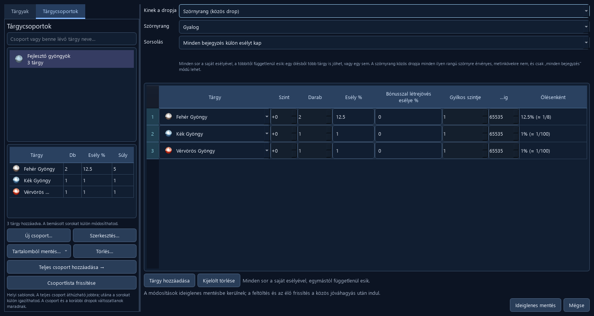
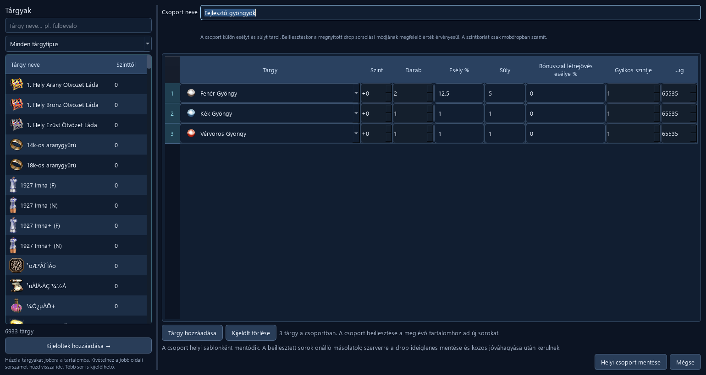
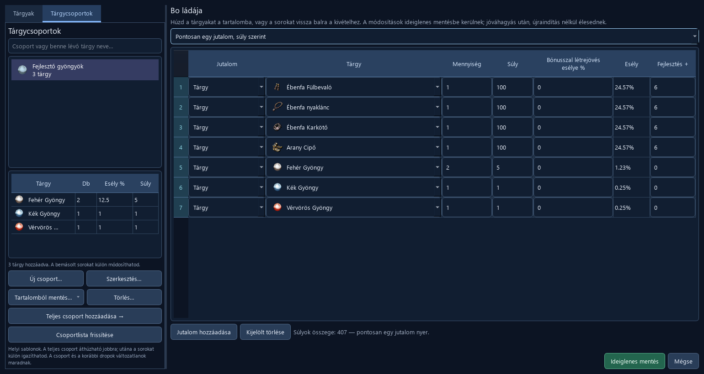

# Újrahasználható tárgycsoportok

A mobdropok és ládák osztott szerkesztőjének bal oldalán a **Tárgyak** mellett
megjelent a **Tárgycsoportok** fül. Az **Új csoport…** üres csoportot nyit,
vagy induló tartalomként beveszi a tárgylistában kijelölt elemeket. A csoport
nevét és sorait külön osztott szerkesztőben lehet beállítani. A
**Tartalomból mentés…** menü a jobb oldali kijelölt sorokból vagy az összes
tárgysorból készít új csoportot. Ládából a pénz és más nem tárgy jutalmak
nem kerülnek a tárgycsoportba.

A csoportlistában névre és a benne lévő tárgyakra is lehet keresni ékezetek
nélkül. A kiválasztott csoport tartalma ikonos előnézetben látszik.
A teljes csoport jobbra húzható, dupla kattintással vagy a hozzáadás
gombbal is beilleszthető. Mindig új, önálló sorok keletkeznek: a másolt
tartalom utólagos igazítása nem változtatja a sablont vagy más dropokat.
A meglévő sorokat a beillesztés megtartja; azonos tárgy esetén is új sor
kerül a végére. A jobb oldali sorok a csoportfül listájára is visszahúzhatók
a kivételhez.

A csoport a darabszámot, fejlesztést, bónusszal létrejövés esélyét és a
mobos gyilkosszint-ablakot is tárolja. Külön esély és súly szerepel benne;
mindkettő szerkeszthető. A cél sorsolása dönti el, melyiket használjuk.
Meglévő esélyes tartalom mentésekor a súly 1, súlyozott tartalom mentésekor
az önálló esély 1% alapértéket kap, amelyet a csoport mentése előtt át lehet
írni. A ládák két tizedesjegynél pontosabb esélyt nem fogadnak, ezért az ilyen
csoport beillesztése világos hibával megáll; nincs csendes kerekítés.

A csoportok szerverenként elkülönített, tartós **helyi sablonok**. Mentésük
nem tölt fel szerveradatot. A dropba másolt sorok a meglévő ideiglenes
mentésen és a **Függő módosítások** közös jóváhagyásán keresztül élesednek.
A csoportlista mentése zárolt és atomikus, a korábbi változat helyi előzménye
megmarad. Az időközben más ablakból átírt csoport és az azonos nevű csoport
felülírását ellenőrizzük; sikertelen mentéskor a szerkesztő tartalma megmarad.
Az érvénytelen tárgyhivatkozás, darabszám, fejlesztés, sorlimit vagy súlyösszeg
a teljes beillesztést elutasítja, részleges másolás nélkül.

Ellenőrzések:

- 12 új csoportteszt: tartós mentés/visszanyitás/átnevezés/törlés,
  előzmények és párhuzamos módosítás, szerverenkénti elkülönítés,
  kijelölt/teljes mobos és ládás tartalom átvétele, mindkét sorsolási mód,
  önálló másolatok, valódi Qt dropesemények, idegen és elavult húzások,
  atomi hibakezelés, ékezetfüggetlen keresés és helyi mentés.
- A catalog_editor, bulk_rewards_editor, manager_change_review,
  manager_pending_changes, manager_name_picker, manager_reward_split és
  manager_reward_groups CTest-csomagok sikeresek.
- A teljes, 6935 tárgyas katalógus próbájában a mobablak 0,595, a ládaablak
  1,045 másodperc alatt nyílt. Egy ideiglenes helyi gyöngycsoport mindkét
  célba sikeresen bekerült; a mobos eredményt a natív katalógusellenőrző
  elfogadta. Ez egy helyi mérés, nem általános sebességígéret.
- A telepített kezelőben valódi egérhúzással beillesztettük a háromelemű
  próbacsoportot, majd megnyitottuk, átneveztük és helyben mentettük a
  sablont. A próbadrop mentés nélkül zárult. A GUI-próba elkülönített
  LOCALAPPDATA könyvtárat használt; próbasablon nem került a felhasználó
  saját csoportjai közé.
- A csomag 249 telepített fájlja és a manifest ellenőrzött. Az öt futó
  szerverfolyamat, a natív binárisok, az élő katalógus és jutalomverzió,
  a két meglévő függő módosítás, valamint a 637 halasztott elem változatlan.

Ez kezelőfelületi és helyi sablonfunkció. Szerver- vagy Unity-játékkód,
protokoll és adatbázisséma nem változott; új Unity-fordítás vagy játékbeli
droppróba nem futott.

