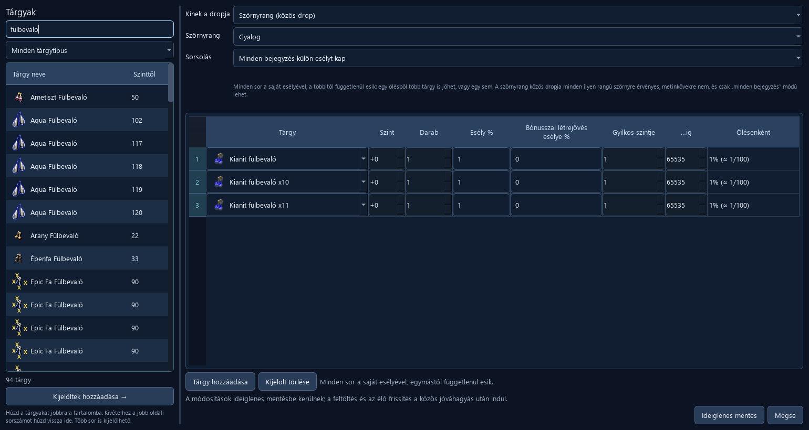
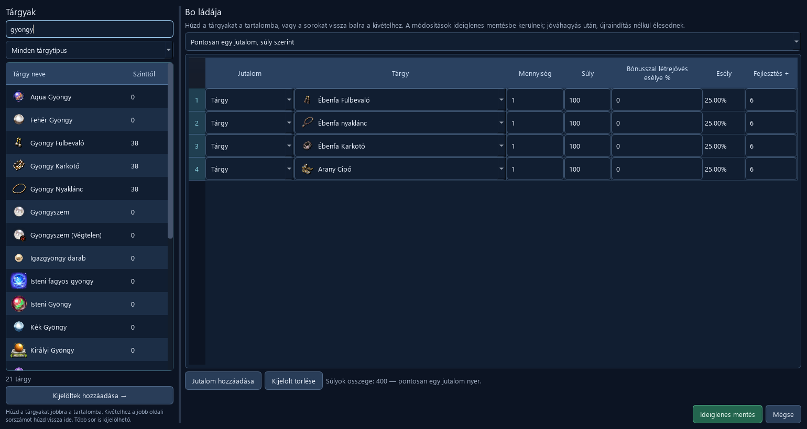

# Ikonos tárgylista és osztott dropszerkesztő

A mobdropok és a használattal/kulccsal nyitható ládák saját szerkesztője bal
oldali tárgylistát és jobb oldali tartalmat használ. Az ékezetfüggetlen keresés
és a kategóriaszűrő a teljes aktív listában működik. A több kijelölt tárgy
áthúzható a tartalomba; a tartalomsorok sorszámuknál fogva húzhatók vissza.
A nyílgomb és a dupla kattintás is hozzáad, a tárgylista nevei nem szerkeszthetők.

A két oldal ugyanazon ablakhoz kötött húzásokat fogadja. A kívülre ejtett,
megszakított, idegen ablakból érkező vagy érvénytelen húzás nem módosítja a
tartalmat. A sorok egyedi helyi tokenjei a pontos kivételt biztosítják;
kivételkor nincs katalógustörlés. A 256 soros határt meghaladó csoport teljes
egészében elutasításra kerül. A meglévő sorok esélye, súlya, darabszáma,
fejlesztése és bónuszolása megmarad. Az utolsó ládasor kivétele a meglévő
„Nincs jutalom” szerveres ábrázolással menthető, üres ládát eredményez.

Az ikoncsomag az aktív Unity projekt eredeti tárgy- és questikonjaiból készült.
A TGA/RLE képeket átlátszóságuk megőrzésével PNG-be alakítjuk, tartalmuk
hash-e szerint egyetlen ZIP-ben deduplikáljuk. A csomag 2670 eszközútvonalat,
2588 különböző képet tartalmaz, mérete 7 556 833 bájt. A teljes katalógus
6598/6935 bejegyzésének van benne eredeti ikonja; a három hiányzó forrásútvonal
337 régi bejegyzést érint. Ezek helyettesítő jelölőt kapnak, az adatuk
nem módosul. Az ikonok a katalógusban, a választókban és az osztott szerkesztőben
is látszanak. Betöltésük lusta, az ikonok gyorsítótárazottak.

Ellenőrzések:

- 12 új Qt-interakciós teszt: több elem valódi dropeseménye, láda/mob
  alapértékek és súlyozott mód, pontos sorok visszahúzása, megszakítás,
  idegen/stale/hibás húzások, teljes sorlimit, utolsó ládasor kivétele,
  sorszámnál indított egérgesztus, dupla kattintás, ékezetfüggetlen szűrés,
  ikonok és a forrásadatok változatlansága.
- A catalog_editor, bulk_rewards_editor, manager_change_review,
  manager_pending_changes, manager_name_picker és manager_reward_split
  CTest-csomagok sikeresek.
- A teljes katalógusban a „fulbevalo” továbbra is mind a 94 találatot adja.
  Két megnyitott szerkesztő próbájához 23 ikon dekódolódott; a mobablak
  0,977, a ládaablak 1,085 másodperc alatt nyílt meg a Qt-próbában. Ez egy
  helyi mérés, nem általános teljesítménygarancia.
- Konzol nélküli csomagépítés és a két natív segéd indítási ellenőrzése.
- A telepített alkalmazásban valódi egérhúzással hozzáadtunk egy Ametiszt
  Fülbevalót egy új, ideiglenes próbaűrlaphoz, majd a sorszámánál fogva
  visszahúztuk a tárgylistára. A pontos sor eltűnt, a 94 találatos tárgylista
  megmaradt. A próbaűrlapot mentés nélkül bezártuk.

A módosítás kizárólag a kezelő felületét és csomagolt képeit érinti.
GameServer- és Unity-kód/protokollváltozás nincs, új gameplay-fordítás vagy
moböléses próba nem futott. A tesztablakok tartalmát nem töltöttük fel.
A meglévő ideiglenes mentés és közös jóváhagyás folyamata megmarad.

Az ikoncsomag újraexportálásához a build Pythonjában PySide6 és Pillow
szükséges. Az exportáló CLI `--catalog` katalóguscsomagot, `--unity` aktív
projektútvonalat és `--output` ZIP-célt vár. A futó kezelőnek Pillow vagy Unity
telepítésére nincs szüksége.
